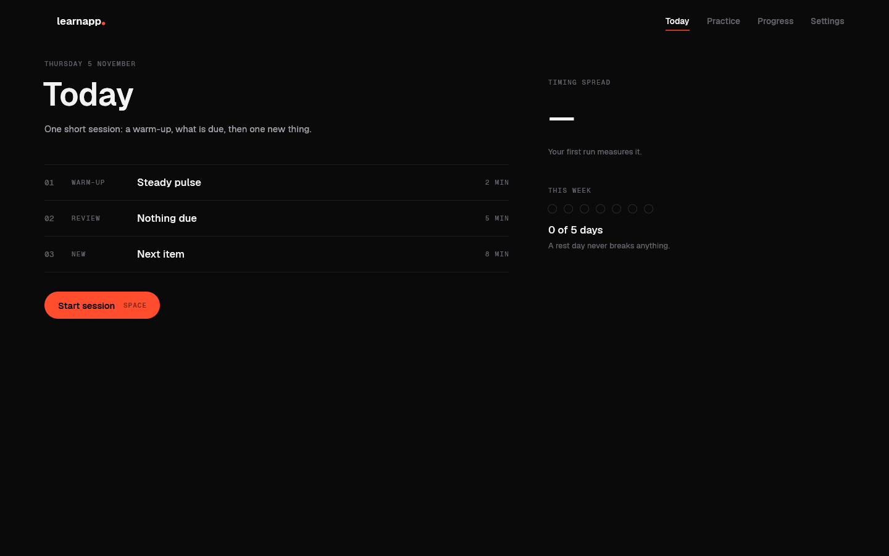
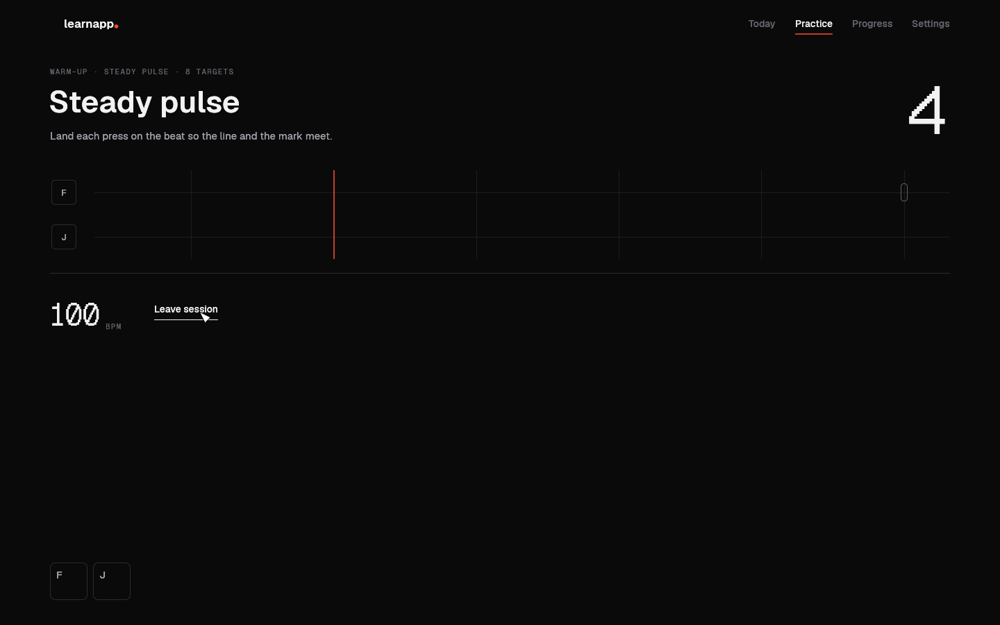
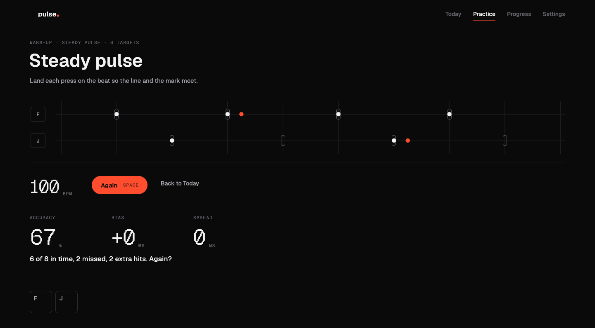

# build-learn-app

A Claude Code skill that builds a complete, good-looking native **Rust learning
app for macOS** for anything you want to learn.

You describe what you want to learn. You answer a few questions. Then the
skill runs the whole thing: research on how people learn that skill,
planning, a parallel multi-agent build in Rust, verification in the real
running app, and a signed release installed on your Mac.

```
/build-learn-app I want to get good at finger drumming on my laptop keys
```

It comes from three real builds: a finger-drumming trainer, a pop keyboard
improvisation trainer and a sound-design course. Every mistake from those
builds is a rule in the skill, so your build does not repeat it.

## What you get

- a git project with research notes (with sources), a grilling log of every
  decision, and a `SPEC.md`;
- a pure-Rust app (eframe/egui) in a calm, dark, typographic design: no
  cards, Geist fonts, one accent colour, lots of space, smooth motion;
- a learning design built on retention, not streaks: short daily sessions,
  spaced review, "learned" only after a clean run on a later day, honest
  measured feedback;
- a project skill `.claude/skills/verify-<app>/` that drives the real app
  like a learner (keys posted only to the app, controls pressed through the
  accessibility tree, in-app screenshots) without disturbing you while you
  work on the same Mac;
- a universal, signed `.app`, installed where you practise; notarization only
  after you say yes;
- a final report that separates what is proven from what only you can judge.

## Screens of the starter

The skill starts every app from a compiling starter with the design system,
input with hardware timestamps, safe storage, a review scheduler, honest
scoring and the verification driver already in place.

| Today | Practice (count-in) |
|---|---|
|  |  |

A scored run from the self-test, captured by the app's own renderer while it
ran in background mode behind other apps. The driver skipped two targets and
pressed two keys twice; the app shows 6 of 8 in time, the two empty targets
and the two extra hits, and says so in the verdict:



## Install

As a plugin (recommended):

```
/plugin marketplace add Niko96-dotcom/build-learn-app
/plugin install build-learn-app@build-learn-app
```

Or copy the skill folder:

```bash
git clone https://github.com/Niko96-dotcom/build-learn-app.git
cp -R build-learn-app/skills/build-learn-app ~/.claude/skills/
```

## Requirements

- macOS on Apple silicon or Intel, with Rust (`rustup`); for universal
  builds also `rustup target add x86_64-apple-darwin`.
- Accessibility permission for your terminal or agent host (the
  verification driver needs it).
- Free disk: 10–30 GiB while agents build.
- Optional: an Apple Developer ID for signing and notarization (otherwise
  the app is ad-hoc signed and other Macs warn on first open).

Check your Mac and prove the toolchain end to end before a real build:

```bash
skills/build-learn-app/scripts/check-env.sh          # read-only, prints check-env: READY
skills/build-learn-app/scripts/selftest.sh /tmp/blas  # builds, drives and bundles a throwaway app
```

`selftest.sh` scaffolds an app, runs fmt/clippy/tests, launches it in
background mode, plays a scored run 15 ms late and checks the app measured
15 ms, checks that misses and extra hits are reported honestly, that leaving
a session scores nothing, that settings and history survive a relaunch, and
builds an ad-hoc signed bundle. It ends with `selftest: PASS` or
`selftest: FAIL (<step>)`.

## How it works

| Phase | What happens |
|---|---|
| 0 Intake | your request against a checklist; your rules files; a machine check |
| 1 Allowances | one question for every permission the build needs, plus questions research cannot answer |
| 2 Research | 4–6 agents in parallel: learning science, the domain canon, existing apps, technology, sources |
| 3 Grilling | 12–20 questions with researched recommendations, then "build it?" |
| 4 Scaffold | the starter, `SPEC.md`, contracts before any agent starts |
| 5 Build waves | parallel agents, one crate each, one shared build folder, a gate before every commit |
| 6 Verify | every feature driven in the real app; drive → fix → re-drive |
| 7 Review | an independent read-only review; fixes re-proven |
| 8 Release | icon, universal signed bundle, install; notarization on your yes |
| 9 Report | proven / not proven / only you can check |

Details: [`skills/build-learn-app/SKILL.md`](skills/build-learn-app/SKILL.md)
and its [`references/`](skills/build-learn-app/references).

## Layout

```
skills/build-learn-app/
  SKILL.md                 the playbook
  references/              questions, research briefs, learning design, architecture,
                           design system, build waves, verification, release, lessons
  templates/starter/       the compiling Rust workspace every app starts from
  scripts/new-app.sh       scaffold a named app from the starter
  scripts/check-env.sh     read-only machine check
  scripts/selftest.sh      end-to-end self-test (one command, PASS/FAIL)
```

## Credits and licences

- Skill, scripts and starter code: MIT (see `LICENSE`).
- Fonts in the starter: [Geist](https://github.com/vercel/geist-font) by
  Vercel, SIL Open Font License 1.1 (`templates/starter/assets/fonts/OFL.txt`).
- The question method follows the "grilling" idea from Matt Pocock's skills
  ([mattpocock/skills](https://github.com/mattpocock/skills)); the verify
  skill follows the create-verification-skill shape (Launch, Doctor, Drive,
  Evidence, Cleanup, and a feature map).
